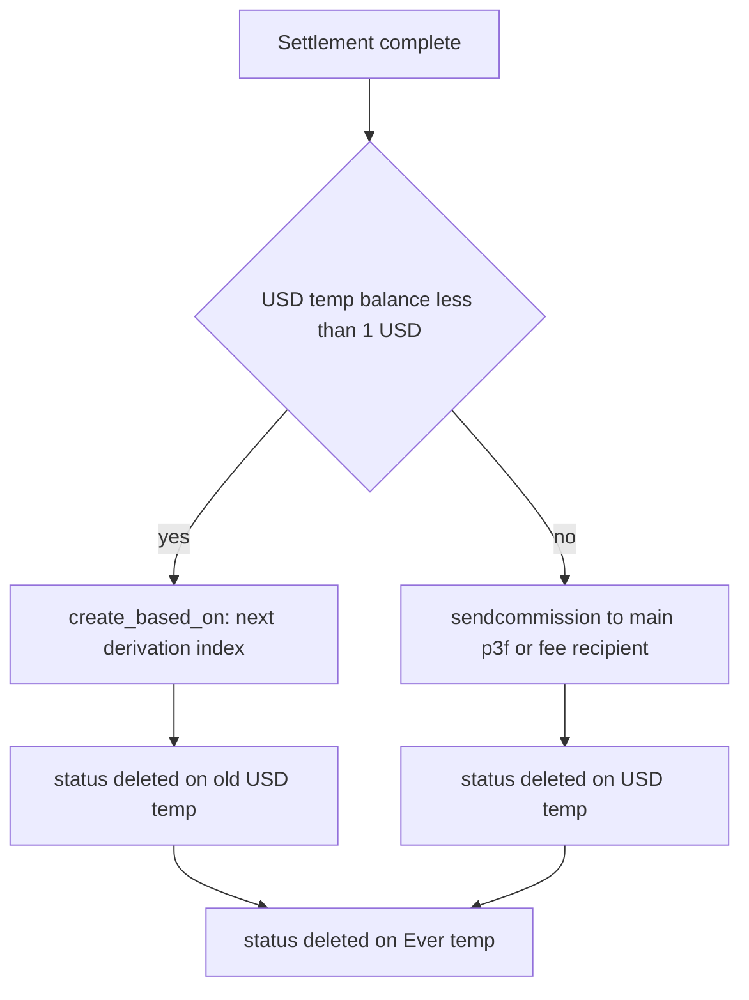

# OTC temporary multi-chain wallets (custodial intermediaries)

This document is the implementation contract for Pay3flow temporary
intermediary wallets. It supersedes the previous “OTC never holds blockchain
signing keys” rule **for platform temp wallets only**. Customer and desk login
keys are still never uploaded. Cross-network conversion still uses NEAR Intents
as an exchange hop; the platform now owns the deposit/source addresses on that
hop.

Related baselines:

- [OTC multi-chain stablecoin requirements](OTC_MULTI_CHAIN_REQUIREMENTS.md)
- [OTC service](otc-service.md)
- [NEAR Intents routes](near-intents-routes.md)
- [Temporary wallet incident runbook](otc-temp-wallet-runbook.md)

Status: **partially implemented**. Phases A–E are implemented for EVM stablecoin
sources behind the off-by-default `OTC_TEMP_WALLETS` flag. Accept creates the
planned 2–3 rows (`ever` + `usd`, or `ever` + `usd_in` + `usd_out`). A
same-network payout is a direct ERC-20 transfer from the USD input wallet, or
from the platform `reserve` when `OTC_TEMP_RESERVE_PAYOUT=1` (preflighted at
Accept); a cross-network payout is an exact-output NEAR Intents quote signed
from that wallet. Phase B key material and signed transaction builders exist for
every chain family through the maintained SDKs, but only the EVM source can be
broadcast today. Only the USD input row is funded: the EVER leg and non-EVM
sources stay on the legacy direct/routed path, so `ever` and `usd_out` are
reserved addresses retired at settlement. Non-EVM settlement (broadcasting) is
not implemented; the non-EVM SDK signers exist but no worker calls them yet.
Operational recovery is in [the runbook](otc-temp-wallet-runbook.md). See §10 for
the checklist and §10.1 for the shipped code paths and deviations.

---

## 1. Why temporary intermediaries

### Problem

Small USDT/USDC deals lose money on bridge/network fees. Peer-to-peer direct
settlement and Intents-only deposits do not give the desk a place to:

- hold the **3%** service fee on-chain before sweeping;
- pay same-network USD from a **reserve** while withholding the counterparty’s
  deposit;
- recycle dust below **$1** without burning a useful address forever.

### Decision

For each accepted P2P deal the backend **creates, stores (encrypted), and
signs** temporary wallets. Users send assets to those addresses. After both
legs are funded and accepted, the backend signs outbound transfers:

- from USD temp → NEAR Intents (or same-chain peer/reserve path);
- from Everscale temp → the USD seller’s main Ever wallet.

### Custody boundary

| Asset | Who holds keys |
| --- | --- |
| User main wallets | User only |
| Desk login / inventory proof wallets | External; not generated here |
| **Temp intermediaries** | **Backend** (ciphertext + per-row salt in Postgres) |
| Main p3f treasury / reserve / fee recipients | Operator-configured; same encrypt pattern or secure env |
| NEAR Intents deposit address | Provider/solver (not our key) |

---

## 2. Supported networks and identities

Canonical network ids (match `route_execution` / route engine aliases):

| Spec name | Canonical id | Family | Coin type / notes |
| --- | --- | --- | --- |
| ETH | `ethereum` | EVM secp256k1 | BIP44 `m/44'/60'/0'/0/i` |
| Polygon | `polygon-pos` | EVM | same EVM key/address as ethereum family |
| Avalanche C | `avalanche-c` | EVM | same EVM key/address as ethereum family |
| TRON | `tron` | secp256k1 + Tron address | Tron derivation / Base58Check |
| Solana | `solana` | ed25519 | Solana pubkey Base58 |
| NEAR | `near` | ed25519 | implicit account hex |
| TON | `ton` | ed25519 | TON-friendly address encoding |
| Aptos | `aptos` | ed25519 | `0x` + 32-byte account |
| Everscale (EVER leg) | `everscale` | ed25519 / EverWallet | reuse `m/44'/396'/…` pattern from evernode-multisig |

Stablecoins: **USDT** and **USDC** only, identified as `(stablecoin, network)`
plus catalog asset id. An EVM `0x…` address never implies the network.

Aliases when accepting config/UI input: `polygon` → `polygon-pos`,
`avalanche` → `avalanche-c`, `sol` → `solana`, `eth` → `ethereum`.

---

## 3. Product floors and fees

### 3.1 Minimum deal size (product)

- Every new offer publish and accept requires **≥ 30 USDT/USDC**
  (`30_000_000` six-decimal units) on the stablecoin leg.
- Desk RFQ `min_usdt` default becomes **`"30"`** (was `"100"`).
- This is a **product** floor so fees do not dominate PnL.

### 3.2 Technical Intents floors (unchanged layer)

`otc::config::minimum_stablecoin_units` and `GET /api/otc/p2p/assets`
`swap_minimums` remain authoritative for **routable** amounts. Example: TRON as
origin still needs ~**100.1** USDT for 1Click. A deal may be ≥ $30 and still be
rejected for a specific route with a clear 400 naming amount, network, and
minimum.

Effective rule:

```text
required = max(30 USDT product floor, network/leg Intents technical floor)
```

### 3.3 Service fee

- P2P policy stays **3%** USDT (`p2p-3pct-usdt-v1`), USDC basis at 1:1.
- Under this design the **3% is withheld on the USD temp wallet** after Accept
  and funding, then swept via `sendcommission()` (or left as dust and recycled).
- Prefer collecting commission on the payment network without bridging a tiny
  fee through Intents.

---

## 4. How many temp wallets per deal

Let:

- `send_chain_usd` = network where the USD seller pays stablecoin into p3f;
- `get_chain_usd` = network where the EVER seller should receive stablecoin;
- Everscale always present for the EVER leg.

| Condition | Temp wallets | Roles |
| --- | --- | --- |
| `send_chain_usd != get_chain_usd` | **3** | `ever`, `usd_in`, `usd_out` |
| `send_chain_usd == get_chain_usd` | **2** | `ever`, `usd` |

Examples:

- EVER ↔ USDT on Ethereum only → 2 wallets (`everscale` + `ethereum`).
- Pay USDT on TRON, receive USDT on Solana, EVER on Everscale → 3 wallets
  (`everscale` + `tron` + `solana`).

Creation happens **once at Accept**, idempotent on `(trade_id, role)`.

---

## 5. Key material, salt, and database

### 5.1 Generator API (logical)

```text
generate(chain) -> WalletMaterial
address(material) -> String
derive_next(parent) -> WalletMaterial   // create_based_on
sign_transfer(material, instructions) -> SignedTx
```

- One **BIP39 master seed** (or chain-family seed) per temp wallet row.
- Secrets only in memory (`zeroize`); never in logs or API responses.
- Public surface: `id`, `chain`, `address`, `role`, `status`.

#### 5.1.1 Required libraries (do not hand-roll chain crypto)

Implementers must use maintained chain SDKs for key derivation, address
encoding, transaction serialization, signing, and broadcasting. Hand-written
RLP/BCS/protobuf/cell encoders are not acceptable for a custodial path.

| Chain family | Required crate / project | Use for |
| --- | --- | --- |
| EVM (`ethereum`, `polygon-pos`, `avalanche-c`) | [`alloy`](https://github.com/alloy-rs/alloy) | secp256k1 keys, addresses, EIP-155/EIP-1559 transactions, RPC providers |
| Solana | [official Solana Rust client](https://solana.com/docs/clients/official/rust) (`solana-sdk`, `solana-client`, `spl-token`) | ed25519 keys, associated token accounts, transaction build/sign |
| NEAR | [`near-api-rs`](https://github.com/near/near-api-rs) | implicit accounts, Borsh transactions, NEP-141 calls, RPC |
| TON | [`tonlib-rs`](https://github.com/ston-fi/tonlib-rs) | wallet contracts, cells/BoC, external messages, signing |
| TRON | [`anychain-tron`](https://crates.io/crates/anychain-tron) | Tron address encoding, TRX/TRC-20 transactions, signing |
| Everscale | existing `evernode-multisig` + `everscale-types` | EverWallet address and contract messages |
| Aptos | [`aptos-bcs`](https://crates.io/crates/aptos-bcs) | ed25519 account, BCS transaction, FA transfer (the SDK's own codec; see the note below on `aptos-sdk`) |

Pin versions in `backend/Cargo.toml` and cover each family with the round-trip
sign/verify tests in Phase B. The wired crates are `solana-sdk` + `spl-token`,
`near-api-types` (the types crate of near-api-rs; the `near-api` RPC client
needs OpenSSL/pkg-config, which the build image does not provide),
`anychain-tron`, `tonlib-core` (the pure-Rust part of tonlib-rs), `aptos-bcs`
and `alloy` for EVM. Avoid the native `tonlib` crate: it needs cmake and a
compiled tonlib, and the pure-Rust core builds everywhere the backend does.
`aptos-sdk` is not linked: every 0.4–0.8 release force-enables
`serde_json/arbitrary_precision`, which changes `serde_json::Value` and breaks
the BestChange provider's untagged number parsing. The Aptos module encodes the
canonical BCS layout with `aptos-bcs` (the SDK's own codec) and pins it with an
`aptos-sdk`-produced golden vector. The generator API above stays chain-neutral; the
SDK lives behind it so callers never depend on a concrete chain crate.

### 5.2 Encryption at rest

Reuse application `SECRETS_KEY`, but **not** as a single global AES key alone:

1. Generate per-row random `salt` (e.g. 16–32 bytes).
2. Derive key: `HKDF-SHA-256(ikm = SECRETS_KEY, salt = salt, info = "otc-temp-wallet-v1")` → 32 bytes  
   (acceptable interim: `SHA-256(SECRETS_KEY || salt)` if HKDF is deferred).
3. Encrypt plaintext seed/private key with **AES-256-GCM**.
4. Store `nonce || ciphertext+tag` as `key_ciphertext` (BYTEA or base64 text).

Rotating `SECRETS_KEY` requires a re-encrypt job; document that ops must not
lose the old key while active temps exist.

### 5.3 Table `otc_temp_wallets`

Suggested columns:

| Column | Type | Notes |
| --- | --- | --- |
| `id` | UUID PK | |
| `trade_id` | UUID FK → `otc_trades` | nullable for recycled pool wallets |
| `role` | TEXT | `ever` \| `usd` \| `usd_in` \| `usd_out` |
| `chain` | TEXT | canonical network id |
| `address` | TEXT | normalized |
| `derivation_index` | INT | for HD / `create_based_on` |
| `salt` | BYTEA NOT NULL | per-row |
| `key_ciphertext` | BYTEA NOT NULL | AES-GCM blob |
| `status` | TEXT | `active` \| `recycled` \| `deleted` |
| `parent_wallet_id` | UUID NULL FK | set when derived from dust parent |
| `created_at` / `updated_at` | TIMESTAMPTZ | |
| Unique | `(trade_id, role)` where `trade_id` NOT NULL | |

Soft-delete: `status = deleted`; do not hard-delete rows that may need forensic
decrypt. Optional later: wipe ciphertext after legal retention.

### 5.4 Main / reserve wallets

Operator env (names illustrative):

- `OTC_TEMP_WALLETS=1` feature flag (default off).
- Per-chain gas RPC already via `p2p_evm_rpcs` / `p2p_chain_rpcs`.
- Main treasury / reserve signing material: same salt+ciphertext table
  (`role = treasury|reserve|fee`) **or** sealed env — implementer picks one and
  documents it in ops runbook.
- Same-chain path **requires** a funded reserve on `get_chain_usd`.

---

## 6. End-to-end workflow (happy paths)

Pseudo-workflow from product:

```text
[Intent: receive USDT on chain1]
Ever seller  -> p3f everscale temp wallet
Usd seller   -> p3f wallet chain2
Accept
-3% usd seller   // remain on USD temp
Send usd p3f temp -> NEAR Intents exchange -> ever seller main USD wallet
  && Send ever p3f temp -> usd seller main ever wallet

if send_chain_usd == get_chain_usd:
  send from main p3f reserve -> ever seller
  withholding_of_funds(usd seller)  // USD stays on temp

temps -> mains (as above)

if temp_usd balance < $1:
  new = create_based_on(old_usd_temp)
  delete(old_usd_temp)   // status=deleted; may leave dust
else:
  sendcommission()       // to main p3f / fee recipient
  delete(usd temp)

delete(ever temp)
```

### 6.1 Cross-network USD (`send_chain_usd != get_chain_usd`) — 3 wallets

> Accept persists the full planned set (`ever`, `usd_in`, `usd_out`). Only
> `usd_in` is funded and settled: the EVER leg stays on the legacy direct path
> and Intents pays the payee's main USD wallet, so `ever` and `usd_out` are
> reserved addresses retired at settlement.

Step-by-step:

1. **Offer exists** with destination `(stablecoin, get_chain_usd)` and Ever terms.
2. **Taker accepts** with source `(stablecoin, send_chain_usd)` and verified
   main wallets for both parties (`usdt_payer`, `usdt_payee`, `ever_payer`,
   `ever_payee` semantics as today).
3. Backend checks `max(30$, technical floors)` and fee recipient / catalog.
4. Backend creates **three** temps: `ever`, `usd_in` on `send_chain_usd`,
   `usd_out` on `get_chain_usd` (if `usd_out` is only needed as Intents
   refund/destination control, still persist it; if Intents pays straight to
   the EVER seller’s main USD wallet, `usd_out` may be unused for custody and
   should be justified in code comments — default: create all three as in the
   product table).
5. UI/API shows:
   - Ever seller pays EVER → `temp_ever.address`;
   - USD seller pays stablecoin → `temp_usd_in.address`.
6. Observers confirm exact amount credits on both temps (same evidence rules as
   current OTC: no client-reported hash alone).
7. **Accept settlement gate**: both funded → freeze fee policy; withhold **3%**
   of USD gross on `usd_in` (do not forward fee through Intents).
8. Backend requests NEAR Intents **exact-output** quote:
   - source: `usd_in` address / asset on `send_chain_usd`;
   - destination: EVER seller **main** USD wallet on `get_chain_usd`;
   - refund address: `usd_in` (our temp);
   - amount out: `net_units` (gross − 3%).
9. Backend **decrypts**, signs, broadcasts deposit from `usd_in` to Intents
   `depositAddress` (+ memo if required).
10. Poll Intents until SUCCESS with `amountOut ≥ net_units`, or FAILED/REFUNDED.
11. In parallel or after USD principal path is safe: sign EVER transfer
    `temp_ever` → USD seller main Ever wallet for the booked EVER amount.
12. Record attempts in `otc_attempts` with `temp_wallet_id`, tx hashes, quote id.
13. **Lifecycle** (§7).

### 6.2 Same-network USD (`send_chain_usd == get_chain_usd`) — 2 wallets

> Accept persists `ever` + `usd`. The EVER leg still uses the legacy direct
> path, so the `ever` row is a reserved address retired at settlement. With
> `OTC_TEMP_RESERVE_PAYOUT=1` the net is paid from the `reserve` wallet row
> instead of the funded temp, and Accept preflights that reserve.

1. Accept creates `ever` + `usd` on that single USD network.
2. Users fund `temp_ever` and `temp_usd` as above.
3. After both funded:
   - **Do not** require Intents for the USD leg.
   - Pay EVER seller’s main USD wallet from **main p3f reserve** for `net_units`.
   - **Withhold** the USD seller’s deposit on `temp_usd` (including the 3%).
4. Sign EVER: `temp_ever` → USD seller main Ever wallet.
5. Later: sweep commission from `temp_usd` / recycle dust (§7).
6. Reserve inventory accounting must debit the reserve and credit when
   withheld funds are swept (ops metric + DB ledger row recommended).

### 6.3 Failure and refund

| Failure | Action |
| --- | --- |
| User underpays / wrong asset | Stay unfunded; expire deal per `payment_seconds` |
| Intents FAILED/REFUNDED | Refund lands on `usd_in`; incident + manual or automated return to USD seller main |
| Partial Intents out | Do not complete EVER payout until policy says otherwise; default: block EVER until USD net delivered |
| Signing/RPC failure | Attempt stays `unknown`/`failed`; idempotent retry with same idempotency key |
| Reserve insufficient (same-chain) | Do not Accept-settle; 409 with clear inventory error |

Timeouts must not mark success. Persist enough to resume after process restart
(quote id, deposit address, memo, temp wallet ids, last status).

---

## 7. Post-deal lifecycle

After principal settlement (USD delivered to EVER seller path + EVER delivered
to USD seller):



### Rules

1. Measure USD temp liquid balance in six-decimal stablecoin units.
2. If **< 1_000_000** (< $1):
   - `new = create_based_on(old)` → same seed family, `derivation_index + 1`,
     new address, new salt/ciphertext row, `parent_wallet_id = old.id`;
   - mark old `deleted` / `recycled`;
   - enqueue `new` into a **reusable pool** for future deals on that chain
     (implementer: either attach on next Accept or keep trade-scoped only —
     **default: reusable pool** so dust addresses are not thrown away empty).
3. If **≥ $1**:
   - `sendcommission()`: sign transfer of withhold/fee (and any residual
     principal owed to treasury) to configured main fee/treasury address on
     that network;
   - mark USD temp `deleted`.
4. Always mark Everscale temp `deleted` after successful EVER payout (no
   recycle pool required unless dust EVER is material — default: delete only).
5. Never log decrypted keys during lifecycle.

---

## 8. NEAR Intents hop (platform-signed)

Differences from today’s user-signed Intents deposit:

| Topic | Today | Temp-wallet design |
| --- | --- | --- |
| Who sends to `depositAddress` | User wallet | Backend from `usd_in` / `usd` |
| Refund address | User source | Temp address we control |
| Gas on source chain | User | Platform must keep gas on temp or sponsor before send |
| Fee 3% | Separate user fee transfer when possible | Withheld on temp; not bridged |

Gas policy:

- Before signing the Intents deposit, ensure native gas on the temp (top-up
  from reserve if below threshold).
- Document per-chain top-up minimums next to `eth_gas_reserve` / chain RPCs.

---

## 9. Observers, API surface, and flag

### Observers

Reuse [`backend/src/otc/chain/`](../backend/src/otc/chain/) patterns for EVM,
TRON, TON, Solana, Everscale. NEAR/Aptos may remain Intents-status-driven until
dedicated observers exist; inbound user→temp on those chains still needs a
defined verification path before marking funded.

### API (illustrative)

- Accept / deal details include `temp_wallets: [{ role, chain, address }]`.
- No private keys in any response.
- Staff/incident tools may show balances and statuses, not plaintext secrets.

### Feature flag

- `OTC_TEMP_WALLETS=0` (default): keep current non-custodial Intents/direct path.
- `OTC_TEMP_WALLETS=1`: Accept creates temps and settlement uses this spec.
- Demo and live DBs stay separate; do not flip live until §10 checklist is green.

---

## 10. Implementation checklist (for the executor)

### Phase A — Spec locked (this doc)

- [x] Product rules: $30 floor, 2/3 wallets, 3% withhold, dust recycle
- [x] Custody + salt encryption described
- [x] Cross-chain and same-chain paths described

### Phase B — Generator crate/module

- [x] `generate` / `derive_next` / address helpers for EVM, TRON, Solana, NEAR,
      TON, Aptos and Everscale (`otc::temp_wallet`)
- [x] Chain SDKs from §5.1.1 wired in; no hand-rolled RLP/BCS/protobuf/cell
      encoding. EVM uses `alloy`; Solana uses `solana-sdk` + `spl-token`; NEAR
      uses `near-api-types` (`ft_transfer` Borsh transaction); TRON uses
      `anychain-tron` (TRC-20 trigger contract); TON uses `tonlib-core`, the
      pure-Rust cell/wallet V4R2 library of tonlib-rs (the native `tonlib` crate
      needs cmake and a tonlib build, so it is not linked); Aptos uses
      `aptos-bcs` (fungible-asset entry function and signed BCS transaction);
      `aptos-sdk` itself is not linked because it force-enables
      `serde_json/arbitrary_precision` and breaks provider parsing, so an
      SDK-generated golden vector pins the byte layout
- [ ] Non-EVM broadcasters: the SDK signers return signed bytes, but no worker
      reads nonces/seqnos from those chains yet, so only EVM sources settle
- [x] Unit tests: BIP39/BIP44 vector, sign/verify round trip, salt round trip
- [x] Zeroize + no Debug on secret types

### Phase C — DB + crypto helper

- [x] Migration `otc_temp_wallets.sql` applied at startup
- [x] Encrypt/decrypt helper with per-row salt (interim `SHA-256(SECRETS_KEY || salt)`
      KDF, as §5.2 permits, plus AES-256-GCM)
- [x] Round-trip tests; key mismatch fails closed

### Phase D — Deal wiring

- [x] Accept creates the planned 2–3 rows (`ever` + `usd`, or `ever` +
      `usd_in` + `usd_out`) for EVM stablecoin sources (flag on, idempotent);
      only the USD input row is funded by the current settlement paths
- [x] Deal payload exposes `temp_wallets`
- [x] The existing EVM observer verifies the transfer into the temp address
- [x] Cross-chain: exact-output Intents quote, signed deposit from the temp,
      status polling, fee withhold/recycle on success
- [x] Same-chain reserve pay behind `OTC_TEMP_RESERVE_PAYOUT`: the net is paid
      from one `reserve` wallet per chain, the payer's whole deposit stays
      withheld, and the sweep in §7 sends that deposit to the fee recipient.
      Accept preflights the reserve balance and native gas and returns a 409
      before creating an address when the reserve cannot front the net. With
      the flag off the net is paid from the funded temp as before
- [x] Attempts link `temp_wallet_id`: a custodial payment attempt stores the
      wallet row that received the deposit (`otc_p2p_attempts.temp_wallet_id`,
      nullable for legacy and non-custodial attempts; existing rows are
      backfilled from the payment leg address)
- [x] A row that fails ten attempts moves to terminal `stalled` instead of
      freezing in a live state; manual recovery is in the runbook

### Phase E — Lifecycle

- [x] After a settled sweep, `create_based_on` creates the next address and the
      old wallet is marked `recycled` (no $1 balance probe; the fee sweep sends
      whatever is left, including a partial fee after cross-network route cost)
- [x] The withheld 3% is sent to the configured fee recipient; without one it is
      marked `fee_retained` for ops
- [x] Every terminal payout state marks the deal's reserved `ever` and
      `usd_out` rows `deleted` (§7 rule 4); the funded input row is recycled

### Phase F — Product floor + docs/API

- [x] Enforce ≥ 30 USDT/USDC on publish/accept/desk
- [x] Keep technical Intents floors; expose via `swap_minimums`
- [x] Update `otc-service.md` and `OTC_MULTI_CHAIN_REQUIREMENTS.md`; the assets
      payload reports the product floor as `min_stablecoin_amount` (OpenAPI has
      no OTC P2P paths to extend)
- [x] Revise “never holds signing keys” wording to the custody boundary in §1

### Phase G — Rollout

- [x] Flag off by default (`OTC_TEMP_WALLETS`, default `0`)
- [ ] Demo enablement + E2E on two-wallet and three-wallet paths
- [x] Incident runbook: stuck temp, Intents refund, reserve depletion
      ([`otc-temp-wallet-runbook.md`](otc-temp-wallet-runbook.md)); there is no
      operator CLI, so recovery is by fixing the blocker and letting the worker
      resume from a safe state
- [ ] Live enablement only with dual RPC, fee recipients, and reserve balances

---

### 10.1 Implementation status (2026-11-21)

The custody layer only creates temp wallets when an EVM signer can sweep them:
the payer must be on Ethereum/Polygon/Avalanche, two RPC endpoints and a fee
recipient on that network must be configured, and the flag must be on.

- Accept creates the planned set for an EVM payer: `ever` + `usd` when both
  stablecoin legs share a network, `ever` + `usd_in` + `usd_out` when they
  differ (a payout network outside the custody set gets `ever` + `usd_in`).
  Only the input row (`usd`/`usd_in`) is funded and settled today, so `ever`
  and `usd_out` are reserved addresses retired at settlement. A same-network payout
  pays the payee directly from the temp wallet, or from the platform `reserve`
  when `OTC_TEMP_RESERVE_PAYOUT=1` (the payer's whole deposit is then swept to
  the fee recipient and `otc_temp_settlements.reserve_units` records the fronted
  net); a cross-network payout asks NEAR Intents for an exact-output quote and
  the worker signs the source-token deposit from the temp wallet. The quote is only accepted when the delivered amount equals the deal
  `net_units` and the required input does not exceed the gross deposit.
- `otc::temp_settle` claims the payout, checks the source token balance and
  native gas, then either transfers directly or submits the Intents deposit.
  The settlement row stores `deposit_address`, `deposit_memo`, `quote_id`,
  `source_units` and `minimum_units`, so a restart resumes polling
  (`intents_submitted`) instead of quoting again.
- On Intents `SUCCESS` the worker records the 3% as collected, sweeps the
  remaining token balance to the fee recipient, and recycles the address. If a
  route cost consumed part of the fee, the shortfall is logged and only the
  remaining balance is swept. `REFUNDED` stops the worker in `intents_refunded`
  (funds are back on the temp wallet for ops); `FAILED` stops it in `failed`.
- Not implemented: non-EVM sources, Ever temporary wallets, a separate
  `usd_out` custody wallet (Intents pays the payee directly and refunds to the
  source temp), gas top-up from a reserve (the worker waits for native gas and
  records the need), quote/status expiry for a permanently pending Intents swap
  (the ten-attempt cap now ends in terminal `stalled`), stale-claim operator
  tooling, and TON addresses.
- Settlement for Solana, NEAR, TON, TRON and Aptos has SDK-built signed
  transactions but still no nonce/seqno reader or broadcaster, so those sources
  keep the legacy direct/routed flow.
- The reserve is generated and sealed on first use. With
  `OTC_TEMP_RESERVE_PAYOUT=1`, Accept preflights the reserve balance and native
  gas for a same-network deal and returns a 409 before creating an address when
  it cannot front the net. The three percent fee is recorded as collected once
  the net is delivered, and the sweep reimburses the reserve.
- Phase G: demo/live enablement and end-to-end runs are not done; the incident
  runbook exists at [`otc-temp-wallet-runbook.md`](otc-temp-wallet-runbook.md).

| Piece | Location |
| --- | --- |
| Key generation, derivation, addresses | `backend/src/otc/temp_wallet.rs` |
| Solana address and SPL transfer signing | `backend/src/otc/temp_wallet/solana.rs` |
| NEAR implicit address and NEP-141 signing | `backend/src/otc/temp_wallet/near.rs` |
| TRON address and TRC-20 signing | `backend/src/otc/temp_wallet/tron.rs` |
| TON wallet-V4R2 address and transfer signing | `backend/src/otc/temp_wallet/ton.rs` |
| Aptos address and fungible-asset signing | `backend/src/otc/temp_wallet/aptos.rs` |
| Salted AES-256-GCM seed storage | `backend/src/otc/temp_wallet.rs` (`seal` / `open`) |
| EVM EIP-1559 signing and ERC-20 calldata | `backend/src/otc/temp_wallet.rs` |
| EVM nonce/gas/fee reads and broadcast | `backend/src/otc/chain/mod.rs` |
| Payout worker, direct/Intents payout, 3% withhold, fee sweep, recycle | `backend/src/otc/temp_settle.rs` |
| Settlement state table | `backend/migrations/otc_temp_settlements.sql` |
| Same-network reserve payout | `backend/src/otc/temp_settle.rs` (`temp_reserve_payout`, `ensure_reserve`) |
| Reserve wallet rows | `otc_temp_wallets` (`role = 'reserve'`, one per chain) |
| Reserved-role retirement (Accept-time `ever`/`usd_out`) | `repo::temp_wallets::delete_role` on every terminal payout state |
| Two/three wallet role planning | `backend/src/otc/temp_wallet.rs` (`plan`, gated on an EVM payer) |
| Table | `backend/migrations/otc_temp_wallets.sql` |
| Repository helpers | `backend/src/otc/repo/temp_wallets.rs` |
| Attempt-to-wallet link | `otc_p2p_attempts.temp_wallet_id` (migration `otc_temp_wallets.sql`) |
| Attempt cap / terminal state | `backend/src/otc/repo/temp_wallets.rs` (`NOTE_ERROR` → `stalled`) |
| Incident recovery | [`docs/otc-temp-wallet-runbook.md`](otc-temp-wallet-runbook.md) |
| Feature flag | `otc::config::Config::temp_wallets` (`OTC_TEMP_WALLETS`) |

`trade_id` references `otc_p2p_trades` because P2P acceptance is the flow that
would create temps here; the spec’s `otc_trades` predates that table.

## 11. Test plan (minimum)

1. **Keygen**: each chain produces a normalized address accepted by
   `validate_otc_wallet_address`.
2. **Salt encrypt**: same plaintext → different ciphertext; decrypt OK; wrong
   `SECRETS_KEY` fails.
3. **Wallet count**: same USD networks → 2 rows; different → 3 rows.
4. **Min amount**: 29.999999 rejected; 30.000000 accepted subject to route
   floors; TRON origin still blocked below technical ~100.1 when routed.
5. **Withhold**: after funding, outbound Intents/reserve amount equals
   `net_units`; 3% remains until commission/recycle.
6. **Lifecycle**: mock balance 0.5 → recycled child; mock balance 5 → commission
   attempt then `deleted`.
7. **Idempotency**: double Accept / double settle does not create duplicate
   temps or double pay.
8. **Flag off**: no temp rows; legacy path unchanged.

---

## 12. Explicit non-goals

- Frontend visual redesign beyond showing returned temp addresses.
- HSM/KMS (DB + salt + `SECRETS_KEY` is the chosen v1).
- Chains outside the table in §2.
- Accepting or storing **customer** private keys.
- Claiming atomic cross-chain swap; Intents + observers remain best-effort with
  explicit failure states.

---

## 13. Doc ownership

When behavior ships, keep this file as the behavioral source of truth for temp
wallets. Narrower API field lists belong in OpenAPI; step-by-step incident and
secrets handling belongs in
[`otc-temp-wallet-runbook.md`](otc-temp-wallet-runbook.md) and the deployment
runbook. If product changes the 2/3 rule, $30 floor, or
custody model, update this document in the same change set as the code.
