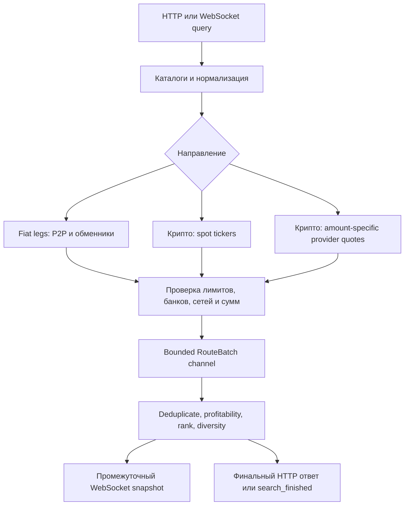

# Пайплайн поиска и виртуализации маршрутов

Актуализировано 2026-10-18 по реализации в текущем репозитории. Документ
описывает публичный поиск SWAP. Отдельные контуры exchange orders и OTC имеют
собственные состояния и правила исполнения: [архитектура](architecture.md),
[OTC](otc-service.md).

## Путь запроса



Оркестрация находится в
[`virtual/pipeline/mod.rs`](../backend/src/p2p/virtual/pipeline/mod.rs), контракт —
в [`routes/`](../backend/src/p2p/routes/), HTTP/WebSocket и обогащение ответа —
в [`server/routing/p2p.rs`](../backend/src/server/routing/p2p.rs).
HTTP возвращает итоговый ответ; WebSocket публикует готовые snapshots по мере
прихода batches. Независимые producers исполняются через `FuturesUnordered`.
Канал `RouteBatch` ограничен 16 сообщениями. Закрытие канала обновлений
останавливает относящуюся к запросу оркестрацию; общий прогрев и общий кэш
провайдеров живут отдельно.

Лимит выдачи не является дедлайном поиска. Время ответа зависит от внешних API,
состояния каталогов, очередей провайдеров и выбранного типа маршрута. Цель
низкой задержки не означает гарантию завершения всех поисков за одну секунду.

## Нормализация и идентичность активов

[`query.rs`](../backend/src/p2p/routes/query.rs) проверяет положительную конечную
сумму, источники, ограничения репутации и способы оплаты. `limit` ограничен
диапазоном 1–100. Явный список `intermediary_assets` (старый alias `assets`)
содержит 1–24 кода; весь серверный каталог этим числом не обрезается.
`max_actions`, если передан, должен быть от 2 до 8.

Код актива нормализуется отдельно от идентификатора сети. Старый ticker `TON`
приводится к `GRAM`, сеть остаётся `ton`. Активы `EVER@ethereum` и
`EVER@everscale` различаются: первый обозначает ERC-20-представление, второй —
нативный EVER. Каталог и наличие значка не доказывают наличие ликвидности.

Выбранная сеть проверяется по общему каталогу и runtime-каталогам провайдеров.
ISO fiat-код без явно выбранной совместимой блокчейн-сети остаётся fiat, даже
если внешний token catalog содержит одноимённый токен.

Capabilities прогреваются конкурентно и переиспользуются из памяти.
При холодном запуске или неполном snapshot отсутствующие каталоги загружаются
через `supported_assets()`; первый поиск не должен молча терять все providers.
Это может увеличить задержку холодного запроса. Реализация —
[`snapshot/capabilities.rs`](../backend/src/p2p/virtual/snapshot/capabilities.rs).
При выборе fiat-workflow intermediaries лимит 12 относится к symbols;
для каждого выбранного symbol сохраняются поддерживаемые варианты сетей.

## Fiat-маршруты и lazy top-K

Для fiat → fiat одновременно ищутся entry и exit для каждого intermediary asset.
Fiat → crypto и crypto → fiat используют соответствующий buy/sell leg, а также
доступные provider workflows. Fiat → crypto может дополнительно сочетать entry
с spot-путём. Прямые fiat-провайдеры и fiat cycles запускаются отдельными
producers, когда выбран режим с обменниками.

P2P-объявления читаются у выбранных venues при пользовательском запросе.
Для direct-exchange допускаются snapshots, Fmatch и ограниченный stale fallback.
`exchange_mode=all` объединяет независимые P2P и direct-exchange результаты,
сохраняя разнообразие источников. Fmatch не становится площадкой исполнения.

Перед составлением проверяются цена, доступный объём, min/max, выбранные
банки, сети и `allow_cross_venue`. Для многошаговых P2P-маршрутов применяется
median outlier filter: по умолчанию 1000 bps, разрешён максимум 5000 bps.
Прямые fiat/crypto объявления не отбрасываются только из-за такого сравнения
с медианой. Неизвестные payment IDs сохраняются как непроверенные оценки.

[`top_k.rs`](../backend/src/p2p/virtual/composition/top_k.rs) не материализует
полное декартово произведение entry × exit. Entry сортируются по цене покупки,
exit — по цене продажи; сначала резервируются разнообразные кандидаты,
затем `BinaryHeap` обходит наиболее перспективные пары. На asset собирается
до `3 * limit` валидных кандидатов. Пропуск комбинаций отражается в
`routes_exhaustive`, а финальное ограничение выдачи выполняется отдельно.

## Обычные crypto → crypto маршруты

Spot producer и route-provider producer работают независимо. Искусственный
fiat pivot для криптообмена не добавляется; `bridge_fiat` эту ветку не определяет.

### Spot

[`composition/mod.rs`](../backend/src/p2p/virtual/composition/mod.rs) строит
прямые и промежуточные пути по загруженным рынкам выбранных бирж. Символ пары
разбирается общими функциями из [`spot.rs`](../backend/src/p2p/spot.rs).
Без явного списка intermediaries дополнительно берётся пересечение соседей
source и target в реальном графе торговых пар, исключая fiat-коды. Поэтому
редкий промежуточный токен не обязан присутствовать в коротком UI-списке.
Это оценка по рыночным данным, а не обещание исполнения ордера или доступной
глубины стакана. Депозит и вывод на бирже остаются отдельными действиями.

### Прямые provider quotes

[`provider/discovery.rs`](../backend/src/p2p/virtual/pipeline/provider/discovery.rs)
перебирает совместимые origin/destination networks выбранных провайдеров,
до 32 network pairs на provider. Запрашиваются котировки конкретной суммы,
проверяются активы, фактический input/output и срок действия. Готовые
котировки сразу поступают в общий поток. Одна пара может дать до восьми
предложений при последующей композиции.

### Два разных провайдера

При `allow_cross_venue=true`
[`crypto_paths.rs`](../backend/src/p2p/virtual/pipeline/provider/crypto_paths.rs)
ищет `source → middle → target` с разными providers. Middle должен совпадать
по символу и сети и поддерживаться обеими сторонами. Явный список intermediaries
ограничивает кандидатов. Приоритет учитывает сеть назначения, USDT/USDC/BTC/ETH
и порядок сетей; перебор ограничен восемью entry-кандидатами и бюджетом до
32 quote jobs на provider в этой фазе.

Второй запрос получает **точный output первого**. Проверяется равенство input
второй котировки этому значению. Округление или выдуманная конверсия между
несовместимыми промежуточными активами не допускается. Повторяющиеся exit jobs
с одинаковыми provider, парой и input разделяют одну future.

Источник может нормализовать только первоначальный пользовательский input:
CoW отбрасывает лишние дробные знаки по decimals реального токена. Например,
`10.1234567 USDT` при 6 decimals становится `10.123456`. Котировка проверяется
против этой нормализованной суммы. Промежуточный output таким образом не
нормализуется. Последовательные сделки исполняются отдельно и не атомарны.
Эти bounded provider searches возвращают `routes_exhaustive=false`.

## Циклы

Одинаковые crypto asset и выбранная сеть запускают поиск возврата в исходный
актив. Wallet/provider cycles и биржевые spot cycles используют разные producers.

Provider cycles выбирают до 48 intermediaries **на каждого** провайдера,
сохраняя разные symbols и варианты сетей. Для входов используется отдельный
последовательный gate, чтобы возвратные запросы не ждали за всей очередью входов.
Возврат котируется на фактический результат первой сделки. Коэффициенты
фонового обмена не подменяют amount-specific quotes в этой ветке.

[`market_cycle.rs`](../backend/src/p2p/virtual/composition/market_cycle.rs) строит
ориентированные рёбра из bid и `1 / ask`; некорректные bid/ask исключаются.
Оценочная торговая комиссия — 0.1% на сделку. По умолчанию сохраняются
двухсделочные возвраты и треугольники одной биржи; смена биржи требует
`allow_cross_venue=true`. Каждая сделка считается действием, переход между
биржами добавляет ещё одно. Явный `max_actions=2..8` расширяет обход с бюджетом
10 000 переходов графа; выбор начальных intermediaries ограничен 96.
Доступность вывода, его сеть, комиссия и глубина рынка не подтверждаются тикером.

Успешный цикл не означает подтверждённую прибыль. `profitability` различает
`confirmed` и `unconfirmed`; неизвестные затраты находятся в `missing_costs`.
Сначала ранжируются подтверждённые прибыльные циклы, затем неподтверждённые,
затем подтверждённые нулевые/убыточные. Лучшие доступные варианты остаются
видимы, даже когда положительная прибыль не подтверждена.

## Бюджеты, ошибки и pacing

Provider workflow ограничен общим timeout 60 секунд, отдельный quote request —
12 секундами. Общий semaphore допускает 16 параллельных provider quotes.
Для direct/composed crypto quotes и wallet cycles применяется одна lane на
provider: запросы одного provider сериализованы, разные providers работают
независимо. Минимальные интервалы начала — 350 мс для Symbiosis и 150 мс для
CoW/NEAR Intents. Ответы 429/quota exceeded блокируют lane на 60 секунд.

В wallet cycles типизированный `QuoteUnavailable`, включая минимальную сумму,
означает недоступный путь; транспортные и прочие ошибки отмечают provider
неуспешным. Direct/composed discovery записывает quote errors в свой
`SourceStatus`. Сохранённый отказ по minimum amount привязан к точным provider,
паре и input, поэтому не исключает другие суммы или направления.

## Кэши и фоновая работа

| Данные | Текущее поведение |
| --- | --- |
| P2P advertisements | Пользовательский live search; готовые provider snapshots не используются как P2P-ответ |
| Direct-exchange snapshots | До 35 минут, stale после 30; до 1024 пар в памяти |
| Fmatch direct-exchange answers | Короткий memory cache, затем live Fmatch, bounded PostgreSQL stale fallback и live providers |
| Exact provider quote cache | До 30 секунд и не дольше `expires_at`; используется только там, где ветка явно обращается к этому кэшу |
| Fiat/provider coefficients | Обновление после 30 минут, TTL 35 минут; оценки для соответствующих workflow/background веток |
| Завершённые route responses | Redis на 15 секунд только для `exchange_mode=exchanger`, непустых и не-stale результатов без failed leg sources; crypto cycles обходят этот кэш |

Ключ общего route cache не содержит anonymous viewer ID. После чтения заново
добавляются пользовательские votes, service links и execution descriptors.
Внешние виджеты получают собственную свежую котировку перед исполнением.
Наличие поля коэффициента в кэше не означает, что все ветки могут им заменить
живую котировку; direct/composed crypto и wallet cycles котируют реальные суммы.

Фоновый poller начинается при запуске сервиса, допускает не более пяти активных
pipelines и новый запуск раз в 2400 мс, то есть до 25 запусков в минуту. Он
обновляет наблюдения обменников и коэффициенты, не опрашивает P2P-объявления и
не строит окончательные пользовательские маршруты. Константы и обход —
[`service.rs`](../backend/src/p2p/service.rs), коэффициенты —
[`snapshot/quotes.rs`](../backend/src/p2p/virtual/snapshot/quotes.rs).

## Итоговый ответ и frontend

[`response.rs`](../backend/src/p2p/routes/response.rs) устраняет дубли по
идентичности маршрута, вычисляет profitability и ранжирует кандидатов.
Для обычных маршрутов приоритет — больший target output, затем проверенные
способы оплаты и same-venue. Обрезка резервирует места для представленных
providers, насколько позволяет `limit`.

`routes_found` — количество найденных уникальных bounded candidates **до**
обрезки отображаемых `routes`. При `routes_exhaustive=false` оно не является
числом всех математически возможных путей. Поиск репутации и tracking events
выполняется отдельно; пользовательский голос не исключает provider из выдачи.

Frontend сохраняет найденные source icons в пределах текущего поиска;
иконка показывает наличие matching offers в диагностике источника, карточка —
собранный маршрут. Большие snapshots отображаются порциями по 100 карточек.
Повторный snapshot не добавляет повторный sample в среднюю latency; cache hit
отмечается отдельно. Исполнение и разделение кошельков описаны в
[SWAP widgets](swap-widgets.md).

## Проверка изменений

Проверять следует нормализацию и сети, сохранение source/provider diversity,
раннюю выдачу batches, точные суммы между legs, источник и свежесть кэша,
ограничения обхода и отсутствие подписи при подключении кошелька.

```bash
cargo fmt --check --manifest-path backend/Cargo.toml
cargo test --all-features --manifest-path backend/Cargo.toml
cargo clippy --all-targets --all-features --manifest-path backend/Cargo.toml
cd pay3low-svelte-frontend
npm run check
npm run test:unit
npm run test:e2e -- tests/exchange-flow.spec.ts tests/wallet-execution.spec.ts
```

Опциональные live-аудиты и их ограничения описаны в
[crypto-pair audit](ever-route-audit.md) и
[frontend audit](frontend-crypto-audit.md). Записанный sample подтверждает
конкретные пары и суммы на момент проверки, а не полное покрытие рынка.
